<div align="center">

# 🏠 KostKita

**Website informasi & pemesanan kost untuk mahasiswa di sekitar Universitas Trunojoyo**

Cari kost, lihat fasilitas & harga, lalu pesan — pemilik kost bisa mempromosikan kostnya lewat panel admin sendiri.


*Proyek tugas kuliah Teknik Informatika (2019) — di-revive & di-dockerize di 2026.*

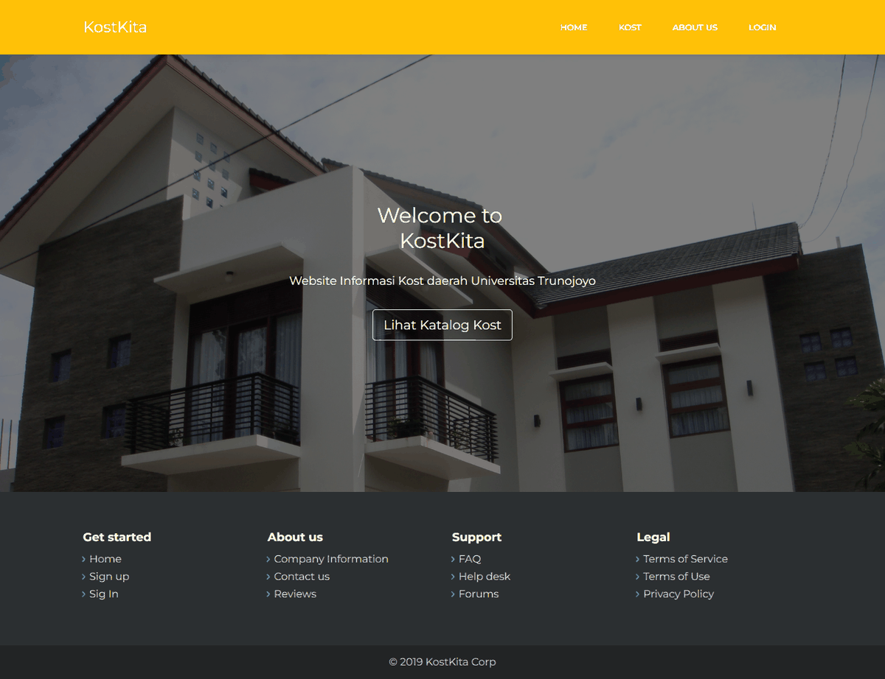

</div>

---

## ✨ Fitur

| Untuk | Fitur |
|---|---|
| 👀 **Pengunjung** | Katalog kost (9 kost/halaman), halaman detail (foto, harga, fasilitas, kontak pemilik), form **Pesan Kost** tanpa harus login |
| 🏘️ **Pemilik kost** | Registrasi & login, tambah kost + **upload foto**, ubah / hapus kost, lihat daftar **pemesan** yang masuk ke kostnya |
| 🛠️ **Admin** | Dashboard statistik (jumlah user, kost putra, kost putri), kelola semua data kost & data user |

## 📸 Tampilan

<table>
<tr>
<td width="50%"><b>Katalog kost</b><br>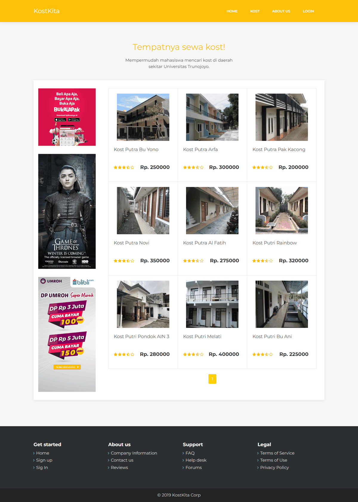</td>
<td width="50%"><b>Detail kost + form pemesanan</b><br>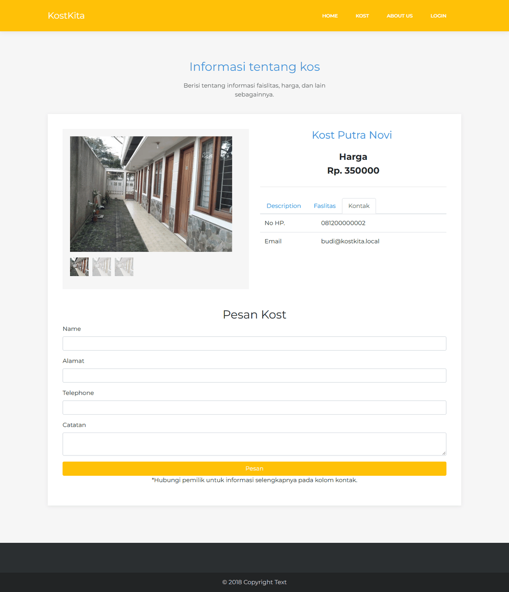</td>
</tr>
<tr>
<td><b>Login</b><br>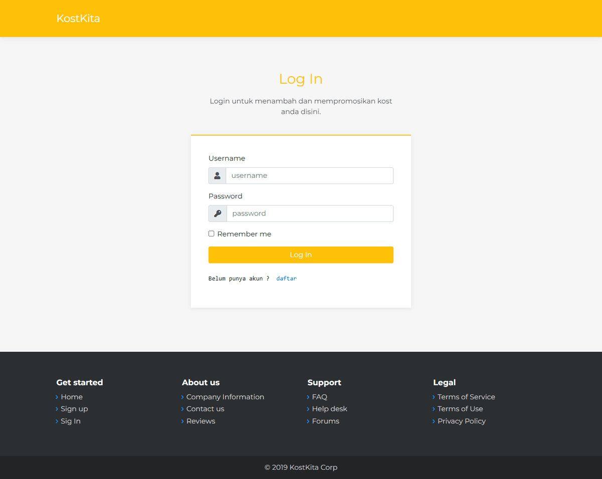</td>
<td><b>Registrasi</b><br>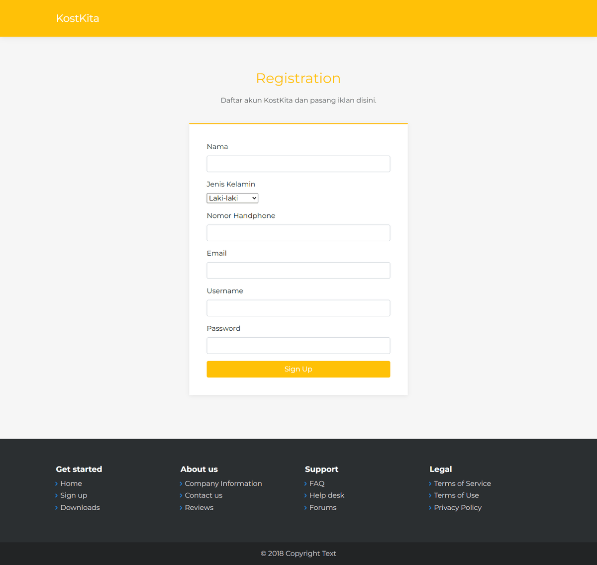</td>
</tr>
<tr>
<td><b>Dashboard admin</b><br>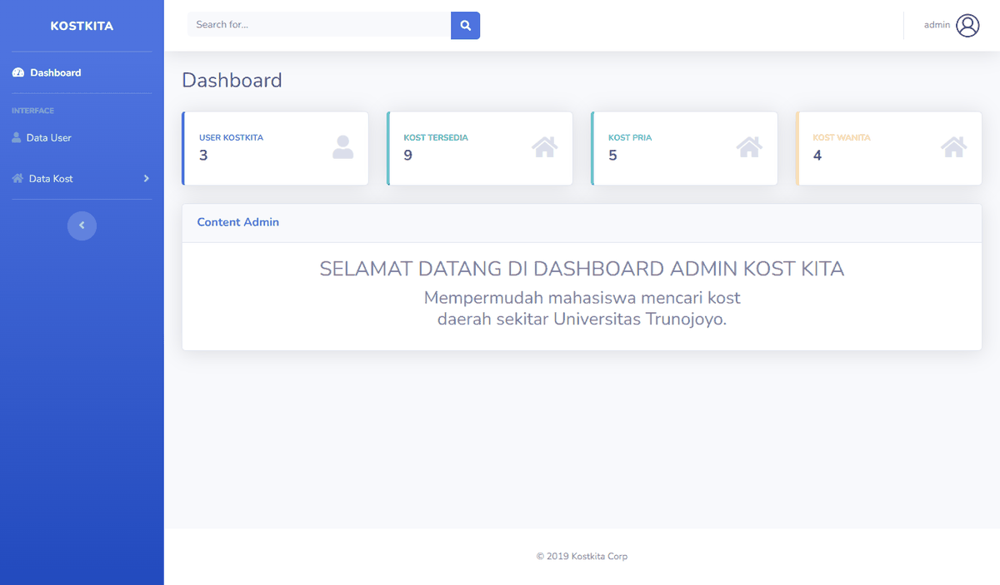</td>
<td><b>Kelola data kost (admin)</b><br>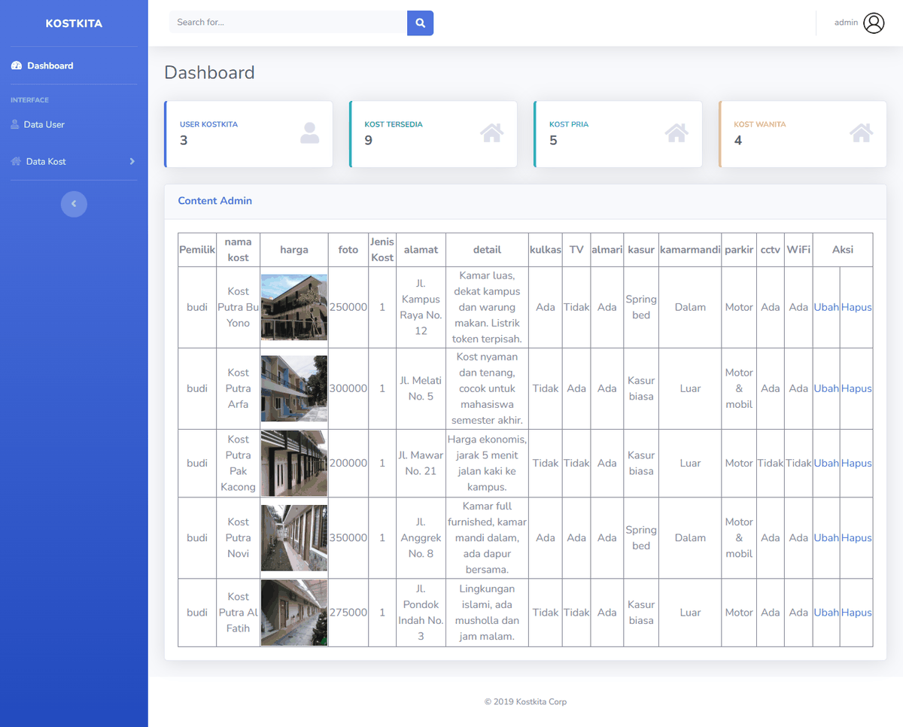</td>
</tr>
<tr>
<td><b>Data user (admin)</b><br>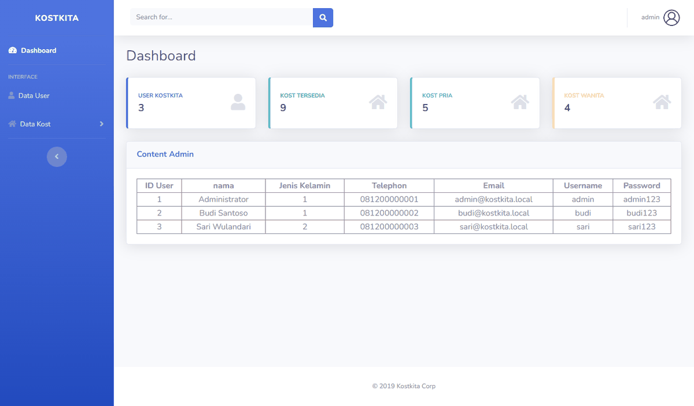</td>
<td><b>Pemesan yang masuk (pemilik kost)</b><br>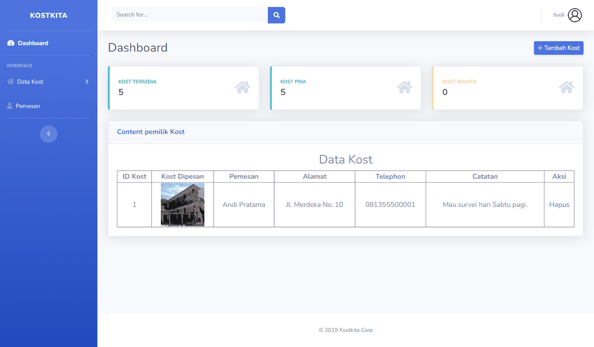</td>
</tr>
<tr>
<td><b>Form tambah kost (pemilik)</b><br>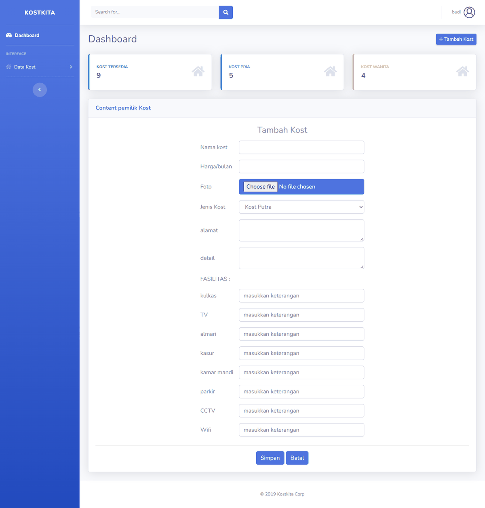</td>
<td><b>Halaman About Us</b><br>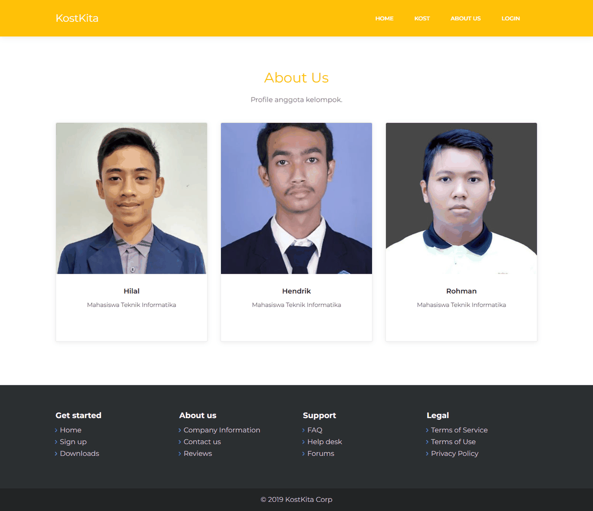</td>
</tr>
</table>

## 🚀 Quick start (Docker — disarankan)

Butuh [Docker](https://docs.docker.com/get-docker/) + Docker Compose. Tidak perlu install PHP/MySQL.

```bash
git clone https://github.com/wicakhendrik/kostKita.git
cd kostKita
docker compose up -d --build
```

Buka **http://localhost:8090** — database `koskita3` otomatis dibuat dan diisi data demo.

Berhenti / hapus:

```bash
docker compose down        # berhenti, data tetap aman
docker compose down -v     # berhenti + HAPUS database & foto upload (reset ke data demo)
```

> Deploy ke server/VPS? Lihat **[DEPLOY.md](DEPLOY.md)** (lengkap, bisa diikuti manusia maupun AI agent).

### 🔑 Akun demo

| Peran | Username | Password | Masuk ke |
|---|---|---|---|
| Admin | `admin` | `admin123` | Dashboard admin |
| Pemilik kost putra | `budi` | `budi123` | Panel pemilik |
| Pemilik kost putri | `sari` | `sari123` | Panel pemilik |

Username **harus persis `admin`** untuk masuk ke dashboard admin (logika asli di `login/cek_login.php`).
⚠️ Ganti password ini sebelum aplikasi dipublikasikan.

## 💻 Alternatif: tanpa Docker (Laragon / XAMPP)

1. Salin folder project ke `C:\laragon\www\kostKita` (atau `htdocs` di XAMPP), nyalakan Apache + MySQL.
2. Import database: buka phpMyAdmin → tab **Import** → pilih [`db/koskita3.sql`](db/koskita3.sql). (File ini sudah `CREATE DATABASE koskita3`.)
3. Buka `http://localhost/kostKita/`.

Koneksi default di [`koneksi.php`](koneksi.php) adalah `localhost` / `root` / *(tanpa password)* / `koskita3` — cocok dengan Laragon & XAMPP bawaan.

## 🧱 Tech stack

- **Backend:** PHP native (mysqli prosedural), tanpa framework
- **Database:** MySQL / MariaDB
- **Frontend:** Bootstrap 4, jQuery, [SB Admin 2](https://startbootstrap.com/theme/sb-admin-2) (panel admin), tema *Clean Blog/Shop* (halaman publik), Font Awesome, Simple Line Icons
- **Deploy:** Docker Compose (`php:8.3-apache` + `mysql:8.0`)

## 🗂️ Struktur folder

```
kostKita/
├── index.php            # Beranda
├── catalog/             # Katalog kost + pagination
├── kost/                # Detail kost + form pemesanan (insert_pemesan_kost.php)
├── about/               # Halaman About Us
├── login/               # Form login + cek_login.php (session)
├── registration/        # Registrasi user baru
├── admin/               # Dashboard admin & pemilik: CRUD kost, data user, data pemesan
├── assets/              # CSS/JS tema publik + assets/img (foto kost, juga tujuan upload)
├── vendor/, css/, js/   # SB Admin 2 (panel admin)
├── koneksi.php          # Koneksi database (bisa diatur lewat env var)
├── db/koskita3.sql      # Skema + data demo
├── Dockerfile, docker-compose.yml, docker/
├── README.md  ·  DEPLOY.md
└── template_admin/      # Salinan mentah template SB Admin 2 (tidak dipakai aplikasi)
```

## 🗄️ Skema database

Repo aslinya **tidak menyertakan dump database**, jadi [`db/koskita3.sql`](db/koskita3.sql) direkonstruksi dari seluruh query di kode.

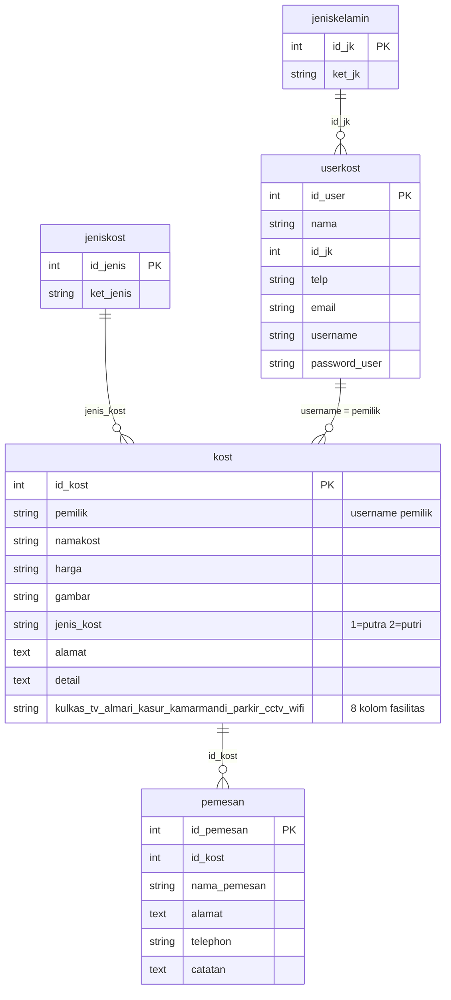

## 🔧 Penyesuaian saat di-revive (2026)

Kode aslinya ditulis untuk PHP 5/7 + MySQL non-strict (XAMPP 2019). Agar jalan di PHP 8 / MySQL 8, hanya **[`koneksi.php`](koneksi.php)** yang diubah — logika aplikasi lain tidak disentuh:

- Kredensial DB dibaca dari environment variable (`DB_HOST`, `DB_USER`, `DB_PASS`, `DB_NAME`) dengan default sama seperti aslinya.
- `mysqli_report(MYSQLI_REPORT_OFF)` — PHP 8.1+ melempar exception untuk error mysqli; aplikasi lama mengandalkan `false`.
- `SET SESSION sql_mode=''` — aplikasi meng-INSERT `''` ke kolom auto-increment (`id_kost`, `id_pemesan`), yang ditolak MySQL strict mode.

## ⚠️ Catatan & known issues

Ini proyek belajar, bukan aplikasi produksi. Yang perlu diketahui:

**Keamanan** — jangan dipublikasikan terbuka ke internet apa adanya:
- Query SQL disusun dengan string concatenation → rentan **SQL injection**.
- Password tersimpan **plaintext** di tabel `userkost`.
- Skrip aksi `admin/delete_kost.php`, `delete_pemesan.php`, `edit_kost.php`, `insert_kost.php` **tidak mengecek session sama sekali** — siapa pun yang tahu URL-nya bisa menghapus/mengubah/menambah data tanpa login.
- Halaman admin memang me-redirect user yang belum login, tetapi tidak memanggil `exit` sesudahnya, jadi isi HTML-nya tetap terkirim ke klien non-browser (curl dll.). Peran juga tidak dicek; parameter `?user=` di URL dipercaya begitu saja.
- Upload foto tidak memvalidasi tipe file (dan bisa dipanggil tanpa login). Di image Docker, eksekusi script di `assets/img/` dimatikan lewat konfigurasi Apache sebagai mitigasi.

Untuk demo publik, taruh di belakang basic-auth / VPN — langkahnya ada di [DEPLOY.md](DEPLOY.md#-keamanan-baca-sebelum-membuka-ke-internet).

**Bug bawaan (sengaja tidak diubah):**
- `admin/insert_kost.php` menyimpan harga sebagai `.250000.` (tanda kutip salah: `'.$harga.'`), jadi kost yang ditambah lewat form tampil sebagai *Rp. .250000.* Data demo memakai angka bersih.
- Halaman login memuat jQuery/Bootstrap JS dari path relatif yang salah (`./assets/...` seharusnya `../assets/...`) → toggle menu mobile tidak jalan di halaman itu.
- Dashboard admin memuat script chart yang tidak ada (404 di console, tidak berpengaruh).
- Detail kost menampilkan field *parkir* di baris CCTV.

## 👥 Tim

Mahasiswa Teknik Informatika, Universitas Trunojoyo Madura — **Hilal**, **Hendrik**, **Rohman**.

Template: [SB Admin 2](https://github.com/StartBootstrap/startbootstrap-sb-admin-2) (MIT) untuk panel admin.
